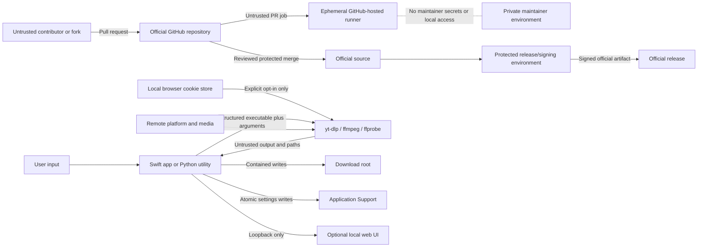

# Track Downloader / Track Downloader Security Model

**Status:** Repository security model and operating guide

**Audience:** Maintainers, contributors, security reviewers, and release operators

**Scope:** Native macOS app, Python utilities, local web UI, build/install tooling, GitHub contribution and CI workflow, and the local-test Chrome native-messaging boundary

**Security-policy authority:** [`SECURITY.md`](SECURITY.md) defines how vulnerabilities are reported. This document defines the broader system model and required controls.

## Overview

Track Downloader is a local-first macOS audio-downloader utility. The native Swift app and the Python utilities validate user-supplied URLs, invoke locally installed `yt-dlp`, `ffmpeg`, and `ffprobe`, write media and metadata under a user-owned output directory, inspect downloaded files, and expose selected results through the app, Finder, or local search links.

There is no hosted Track Downloader backend. The project should not transmit the user's URLs, browser cookies, media, library state, logs, or quality reports to a Track Downloader-operated service. Platform requests are made by the locally installed upstream tools selected by the user or resolved by the app.

The security objective is not to hide the source code. The objective is to ensure that public source, untrusted contributions, untrusted URLs and metadata, third-party tools, and build automation cannot obtain unintended authority over:

- the maintainer's GitHub account, Mac, credentials, or private development material;
- a user's browser cookies or authenticated platform session;
- files outside the configured download and application-support roots;
- the official repository, release channel, bundle identity, or signing process;
- the integrity and availability of downloaded audio and library organization;
- security-report details before a fix is available.

The initial open-source release is source-first. A public source release is not proof of notarized binary distribution, end-to-end platform compatibility, or authorization to download any particular media.

### Current production surfaces

The currently implemented runtime consists of:

- the SwiftUI macOS app under `Sources/TrackDownloader/`;
- reusable validation and parsing code under `Sources/TrackDownloaderCore/`;
- Python command-line, dialog, and loopback-web utilities under `track_downloader/`;
- local build and installation scripts under `script/`;
- a GitHub Actions test workflow under `.github/workflows/ci.yml`;
- local files written under the configured download directory and the user's Application Support directory.

The optional Chrome extension and native-messaging host are implemented for local development and are not a published or signed distribution surface. Their trust boundary remains documented here so later packaging cannot silently widen authority.

### Security ownership

The maintainer owns repository access, merge decisions, releases, GitHub security settings, signing identities, and incident response. Contributors can propose changes but do not receive write, release, signing, secret, or local-machine access merely by opening an issue, fork, or pull request.

Security controls documented as **required** are release gates. They must not be described as active until they are implemented or configured and verified on the public repository.

## Threat Model, Trust Boundaries, and Assumptions

### Assets and privileges that matter

| Asset or privilege | Why it matters |
| --- | --- |
| Official repository and protected branch | Defines the source users are expected to trust. |
| Maintainer GitHub account, SSH keys, tokens, and connected apps | Can alter code, settings, workflows, tags, and releases. |
| Apple signing and notarization credentials | Can make a malicious binary appear to be an official macOS release. |
| Browser cookies and authenticated sessions | May grant access to private, paid, age-gated, or account-specific platform content. |
| Download directory and existing media | Must not be overwritten, deleted, disclosed, or escaped through crafted paths. |
| Application Support data | Contains library organization and may later contain durable queue state and source identifiers. |
| Local logs and `.info.json` sidecars | May reveal media URLs, account-related metadata, filenames, or listening/downloading history. |
| CI token, Actions configuration, caches, and artifacts | Can affect repository integrity or disclose data if overprivileged. |
| Upstream executables and package sources | Run with the user's local account authority and process untrusted network content. |

### Actors and capabilities

**Ordinary user:** Controls pasted URLs, command-line options, output choices exposed by the CLI, cookie opt-in, and local installation. The user is trusted to authorize their own requested download, but input mistakes must remain recoverable.

**Remote content and platform operator:** Controls HTTP responses, redirects, media containers, thumbnails, metadata, extractor-visible filenames, playlist contents, and availability. This material is untrusted even when it comes from an allowed hostname.

**Malicious contributor:** Can fork the public repository, edit any file in the fork, propose workflow/build/test changes, and attempt social engineering. The contributor has no write or merge authority, no repository secrets, and no access to the maintainer's Mac unless a maintainer runs the code locally.

**Dependency or supply-chain attacker:** May compromise an upstream action, package, Homebrew formula, `yt-dlp`, FFmpeg, a download mirror, or a path-resolved executable. This actor may gain code execution wherever the compromised component runs.

**Local unprivileged process:** May influence environment variables, writable `PATH` entries, files, symlinks, loopback requests, or user-writable application directories. It is outside the repository's ability to defend against a fully compromised macOS user account, but the app must not turn a low-authority input into broader file or credential access.

**Maintainer-account attacker:** Has obtained a password, session, token, SSH key, OAuth grant, or signing identity. Account hardening and release verification limit this risk; source review alone does not.

### Assumptions

- macOS, GitHub, Chrome, Homebrew, Xcode/SwiftPM, Python, `yt-dlp`, and FFmpeg have their own security boundaries and update mechanisms.
- A user who intentionally supplies an arbitrary executable path or raw `yt-dlp` option through the advanced CLI is acting as the local operator. Those capabilities must never become remotely controllable.
- The configured download directory and Application Support directory are owned by the current user and are not intentionally shared with an untrusted account.
- The official source is identified by the maintainer-controlled GitHub repository. A fork is not an official release.
- No security property depends on source secrecy. Public knowledge of algorithms, paths, formats, and architecture must not grant credentials or authority.
- The project cannot guarantee that a user is legally or contractually permitted to download a URL. It must state and preserve the authorized-use boundary and must not bypass DRM, paywalls, or access controls.
- A fully compromised maintainer Mac or GitHub administrator can defeat repository-level controls. Account isolation, backups, credential rotation, and independent release verification remain necessary.

### Trust-boundary map

### Boundary inventory

| Boundary | Input crossing it | Required decision point |
| --- | --- | --- |
| Fork to official repository | Source, tests, workflows, scripts, documentation | Maintainer review, protected merge, required CI, security checks |
| GitHub to CI runner | Repository source and workflow | Ephemeral hosted runner, read-only token, no release secrets on PRs |
| User to application | URL, CLI options, cookie choice, file actions | Strict parsing, allowed capabilities, explicit consent |
| Application to executable | Executable URL and argument vector | Trusted resolution, no shell interpolation, version visibility |
| Platform to extractor | HTTP responses, redirects, playlists, media, metadata | Upstream validation, timeouts, size/resource controls where owned |
| Extractor to application | Progress records, output paths, JSON sidecars, diagnostics | Strict record parsing, bounds, path containment, redaction |
| Application to filesystem | Audio, sidecars, archive, logs, organization data | Owned roots, symlink resolution, atomic writes, no broad deletion |
| Browser to native host (local test) | Versioned native message, canonical URL, and bounded visible display text | Exact extension identity, framing limits, schema and URL validation |
| Source to official release | Build inputs, dependencies, signing credentials | Protected tag, clean build, manual approval, signing/notarization |

### Input classification

**Attacker-controlled or untrusted:** URLs, URL components, remote responses, redirects, page DOM, native messages, metadata fields, filenames, thumbnail/artwork bytes, media containers, extractor output, sidecar JSON, issue/PR text, contributor code, contributor tests, contributor workflows, and downloaded archives.

**Operator-controlled:** advanced CLI executable selection, `--extra-ytdlp-arg`, output directory, local environment, browser-cookie choice, build mode, install root, and explicit release action. Operator control is not permission to let remote input reach the same capabilities.

**Developer-controlled:** source code, dependency declarations, GitHub Actions configuration, tests, bundle template, application identity, and release scripts. These become untrusted when proposed by an external pull request until reviewed and merged.

### Repository-wide security invariants

1. Untrusted contributor code never executes on the maintainer's Mac, a self-hosted runner, or a runner holding maintainer or release secrets.
2. Only authorized maintainers can merge to the protected default branch, create official release tags, alter repository security settings, or access signing material.
3. Pull-request workflows use a read-only token, receive no maintainer secrets, and never combine privileged `pull_request_target` execution with checkout or execution of fork-controlled code.
4. Every executable is invoked through an explicit executable path and argument array; remote or metadata input never becomes a shell program, executable name, environment variable name, or raw privileged option.
5. Browser-cookie access is disabled by default and occurs only after explicit, informed user consent for an account the user controls.
6. URL validation occurs at every entry point. Current public download entry points must allow only intended schemes and supported hosts; redirects and final identities remain untrusted.
7. Extractor-reported files, transcript fallbacks, sidecars, artwork, caches, archives, queue databases, and organization files remain within their owned roots after symlink resolution.
8. The app never deletes, overwrites, moves, or reorganizes downloaded audio as a side effect of metadata organization, remote playlist changes, queue recovery, or cleanup.
9. Logs, issues, CI output, crash reports, screenshots, and fixtures do not expose cookies, authorization headers, credentials, personal media URLs, account names, local history, or private absolute paths.
10. Build and installer deletion targets are fixed descendants of validated temporary or `Applications` roots; broad roots, relative roots, symlink escapes, and glob-derived targets are rejected.
11. Official binary releases are reproducibly tied to a protected source revision and are signed with protected credentials. Pull requests cannot trigger privileged publishing.
12. A queued, downloaded, inspected, installed, signed, or published state is reported only after that exact state is verified; one state is not evidence of another.
13. Extension messages can request only a supported URL and request kind with bounded visible title, creator, platform, and timestamp metadata. They cannot request output paths, file reads, cookie sources, arbitrary processes, shell arguments, deletion, or configuration changes.

## Attack Surface, Mitigations, and Attacker Stories

### 1. Public repository and contribution workflow

Opening the source permits anyone to read and fork it; it does not grant write access. The realistic attack is a pull request that hides malicious behavior in application code, tests, scripts, dependencies, or workflows, or that persuades a maintainer to run the branch locally.

Required public-repository controls:

- Create the public repository from a curated one-commit snapshot. Do not publish the current private development history, deleted artifacts, internal plans, or generated executables.
- Protect `main` with a GitHub ruleset: require pull requests, required status checks, resolved conversations, blocked force-pushes, and blocked deletion.
- Keep write access limited to trusted maintainers. External contributors work through forks.
- Add `CODEOWNERS` coverage for `.github/`, `script/`, `Package.swift`, `pyproject.toml`, `Sources/TrackDownloader/Services/`, `Sources/TrackDownloaderCore/`, and cookie/release/install code.
- Do not auto-merge contributor, bot, dependency, or AI-authored pull requests.
- Review the final diff after the last contributor push. New commits invalidate the earlier security judgment.
- Prefer small pull requests with one coherent purpose. Treat generated or minified code as release artifacts, not review substitutes.

**Attacker story:** A contributor adds a useful UI improvement and changes a test helper to upload environment variables. Required review of test, workflow, and process code plus a secrets-free hosted runner prevents access to the maintainer environment; protected merge prevents the code becoming official without approval.

### 2. GitHub Actions and CI supply chain

The current workflow runs Swift and Python tests on a GitHub-hosted macOS runner and declares `contents: read`. The source tree pins official actions to reviewed full commit SHAs and disables checkout credential persistence. Those files remain proposed controls until they run successfully in the curated public repository.

Before public release:

- Pin every action to a reviewed full commit SHA and retain the readable version in a comment.
- Allow only GitHub-owned or explicitly approved actions and reusable workflows.
- Require manual approval for workflow runs from all external contributors, not only first-time contributors.
- Inspect changes under `.github/workflows/`, build scripts, package manifests, and test commands before approving a fork workflow.
- Never use a self-hosted runner attached to a personal Mac for public pull requests.
- Keep `pull_request` jobs secrets-free and read-only. Do not enable settings that send write tokens or secrets to forks.
- Do not use `pull_request_target` to fetch, checkout, build, test, or otherwise execute fork-controlled content.
- Enable CodeQL for Swift, Python, and GitHub Actions, plus dependency and action update alerts.
- Separate ordinary CI from release jobs. Release jobs run only from protected revisions/tags and require an explicit protected-environment approval.

**Attacker story:** A fork changes `Package.swift` or a test command to execute a payload. The payload can affect the disposable runner, but it receives no personal files, signing material, or repository write token. The maintainer reviews the changed workflow and build files before allowing the run.

### 3. Maintainer account and official release integrity

Repository controls cannot compensate for a stolen maintainer session or signing identity.

Required controls:

- Use a phishing-resistant passkey or hardware security key and retain recovery codes offline.
- Review SSH keys, deploy keys, personal access tokens, OAuth apps, GitHub Apps, and active sessions regularly.
- Prefer short-lived, fine-grained tokens limited to the one repository and exact required permissions.
- Use a GitHub noreply commit email when personal email disclosure is unnecessary.
- Sign protected release tags. When binary releases begin, sign and notarize the app and publish hashes and source revision information.
- Store Apple signing credentials only in a protected release environment; never in the repository, ordinary CI, local logs, or pull-request jobs.
- Keep an account-recovery record and at least one offline copy of the canonical source and release receipts.

**Attacker story:** An attacker publishes a similarly named fork or unsigned `.app`. The official repository location, protected signed tag, published digest, and later Developer ID/notarization distinguish it from the maintainer's release.

### 4. URL and network input

The app accepts URLs that ultimately drive a network-capable extractor. Host validation reduces accidental scope, but the remote service still controls redirects, response sizes, playlists, media, and metadata.

Current controls include compatible Swift and Python host allowlists, HTTPS enforcement, embedded-credential rejection, and structured argument construction. Security requirements across every entry point are:

- Permit HTTPS only for normal public download flows. Any development-only HTTP behavior must be separately scoped and unavailable in release builds.
- Reject URLs containing embedded usernames or passwords so credentials cannot be smuggled into process arguments, output, or logs.
- Normalize and validate scheme, hostname, route, URL length, and requested kind before execution.
- Do not rely on suffix or display text alone when an authoritative parsed host or provider identifier is available.
- Treat redirects, playlist expansion, extractor-selected formats, and final metadata as untrusted.
- Keep the legal/authorization decision explicit; host allowlisting is not proof that a download is permitted.
- Ensure the Swift app, Python dialog, CLI, local web UI, and future extension apply compatible validation contracts rather than drifting independently.

**Attacker story:** A crafted URL uses a misleading hostname or unsupported scheme to reach an unintended service. Consistent parsed-host and HTTPS enforcement rejects it before `yt-dlp` runs.

### 5. Process execution and local tool resolution

The Swift `ProcessRunner` uses `Process.executableURL` and an argument array rather than a shell command string. This materially limits shell injection. `ToolResolver` checks common absolute locations before environment `PATH`. The advanced Python CLI allows an operator-selected executable and raw extra `yt-dlp` arguments.

Required controls:

- Preserve array-based process invocation; never concatenate a shell command from URLs, filenames, metadata, or native messages.
- Resolve production executables from documented trusted locations and expose the resolved path and version for diagnosis.
- Treat writable or unexpected `PATH` locations as lower trust. A privileged release or installer must not inherit arbitrary tool resolution.
- Keep `--yt-dlp-bin` and `--extra-ytdlp-arg` as explicit advanced local-operator capabilities only. They must never be accepted through the GUI, loopback API, extension, playlist metadata, or native message.
- Maintain cancellation ownership so the app terminates only its own active child.
- Bound captured output and diagnostic persistence so a malicious or broken child cannot exhaust memory or disk indefinitely.

**Attacker story:** A compromised writable directory contains a fake `yt-dlp`. Trusted-path resolution, visible version/path reporting, and dependency verification reduce the chance that it silently receives browser-cookie authority.

### 6. Browser cookies and private account data

Browser cookies are the highest-sensitivity runtime capability currently contemplated. They can represent authenticated access and may contain personal session information even though Track Downloader does not need to read or display their raw values itself.

Required controls:

- Cookie use is off by default in every GUI and native flow.
- Enabling cookies requires explicit user action and explains which browser profile will be accessed and why.
- Cookie choice is configuration, not URL, page, extension, metadata, or contributor input.
- Never log cookie values, cookie database contents, authorization headers, or upstream commands if their representation could reveal secrets.
- Never include browser profiles, cookies, media URLs, account names, or download logs in tests, issues, screenshots, artifacts, or support bundles.
- The planned Chrome extension must not request Chrome's cookie permission or transmit cookie material. Any authorized cookie use remains inside the local native downloader.

The current source defaults browser-cookie access to off in both the native Swift and legacy Python GUI flows. The Python CLI retains an explicit `--cookies-from-browser` operator option. The exact curated public snapshot must preserve and re-verify this behavior.

### 7. Extractor output, downloaded files, and metadata

`yt-dlp` and remote platforms influence filenames, output records, sidecars, thumbnails, and media contents. These values cross back into privileged local file APIs and media parsers.

Existing Swift controls include strict recognized progress-record prefixes and symlink-resolved output-root checks for final paths, transcript fallbacks, library audio, and sidecars. Atomic organization writes protect the last valid local organization state.

Required controls:

- Apply the same symlink-resolved containment invariant to every code path, including legacy Python fallbacks, artwork caches, archive files, queue state, and future playlist assets.
- Treat file extensions as a filter, not proof of safe content.
- Bound JSON, image, log, native-message, and metadata sizes before loading them wholly into memory.
- Decode images/media through platform libraries defensively and keep dependencies updated.
- Never follow a sidecar, artwork, or audio symlink outside the configured root.
- Do not use remote metadata to form arbitrary Application Support paths, process arguments, search commands, or UI markup.
- Preserve audio when metadata or quality inspection fails. Recovery must not broaden filesystem scope.

**Attacker story:** Extractor output reports `/outside/private/file.mp3` or an in-root symlink points outside the library. The application resolves the candidate and root, rejects the escape, and does not inspect, reveal, or organize the outside file.

### 8. Local logs, sidecars, organization data, and privacy

The application writes a last-download log, quality report, download archive, `.info.json` metadata, and library-organization data. These remain local but may reveal personal activity.

Required controls:

- Document the exact local files and how the user can remove them without deleting media.
- Store only data needed for product behavior; do not add telemetry by default.
- Redact credentials and authorization material before persistence.
- Do not upload local artifacts automatically. A support report is explicit, previewable, and redacted before sharing.
- Keep Application Support files user-readable only where practical and write state atomically.
- Avoid placing private absolute paths in repository fixtures, issue forms, CI output, screenshots, or public documentation.
- Treat downloaded media filenames, source URLs, playlist identities, and account-specific metadata as private even when they are not credentials.

**Attacker story:** A user posts a failure log in a public issue. Issue templates, contributor guidance, and support tooling instruct the user not to publish URLs, account names, cookie data, or complete unredacted logs; maintainers remove and rotate exposed data when necessary.

### 9. Python CLI, dialog utility, and loopback web UI

The Python surfaces are separate entry points and must not inherit trust from the Swift app's tests. The CLI intentionally exposes advanced local capabilities. The optional web UI binds to `127.0.0.1` on an ephemeral port, which prevents direct non-loopback listening but does not make every browser-origin request trusted.

Required controls:

- Keep the web server loopback-only and use an unpredictable per-launch authorization token for state-changing endpoints.
- Validate `Origin`/request context where browser behavior permits, use POST for mutations, set defensive response headers, and reject unsupported content types.
- Bound request-body sizes and request timeouts before reading JSON.
- Do not expose arbitrary executable, argument, file, cookie, search, or quit capabilities to unauthenticated loopback callers.
- Keep the random port and do not add LAN binding without a separate authenticated design and threat review.
- Bring Python URL and output-path validation to the same host, HTTPS, and containment standard as the native app.
- Treat dry-run output as potentially sensitive because it can include URLs, output paths, and selected browser names.

**Attacker story:** A malicious webpage probes loopback ports and attempts to start a download or terminate the local server. A per-launch token, request bounds, origin checks, and capability-minimal endpoints prevent an unauthenticated state change.

### 10. Build and installer scripts

The build stages mutable SwiftPM state and bundles under a guarded temporary root. The installer validates an absolute `Applications` destination, checks the exact bundle identifier, verifies signatures, and uses a staged/backup swap. Those controls limit destructive scope and preserve recovery.

Required controls:

- Preserve explicit validation before every recursive removal or replacement.
- Never use unresolved environment variables, broad roots, globs, user-supplied bundle names, or repository roots as deletion targets.
- Resolve and verify symlinks for build, staging, install, target, and backup paths before destructive operations.
- Keep install tests isolated under temporary `Applications` directories.
- Verify the final installed bundle after the swap and restore the last verified bundle on interruption or failure.
- Treat changes to installer, bundle identity, signing, entitlements, and release scripts as security-sensitive CODEOWNERS paths.
- Do not run release installation or signing from untrusted pull-request workflows.

### 11. Local-test Chrome extension and native messaging

The extension is implemented as a local-development surface, not a published control. It creates a browser-page-to-native-app boundary that must remain narrow.

Mandatory design invariants:

- Manifest V3 with packaged code only; no remotely hosted executable code.
- Permissions limited to exact YouTube, YouTube Music, and SoundCloud hosts, native messaging, and minimal non-sensitive extension storage. No `<all_urls>`, cookies, downloads, history, broad tabs, or web-request interception.
- Content scripts and page DOM are untrusted. The service worker and native host revalidate every request.
- Native messaging accepts one versioned, size-bounded envelope from one exact extension ID.
- Messages can contain only request ID, supported action/kind, canonical HTTPS URL, bounded timestamp/protocol fields, and bounded title, creator, and platform text visible on the page.
- The native host persists a valid request before acknowledging success and has no downloader, cookie, arbitrary process, file-read, path-selection, or deletion capability.
- Queue and artwork data are bounded, transactional, stored under Application Support, and never exposed through a listening network service.
- Extension installation, native-host registration, packaging, and release identity receive dedicated tests and security review.

### Existing mitigations verified in source

- Swift uses executable-plus-argument process APIs instead of invoking a shell.
- The active child process is owned and cancellation targets only that process.
- Swift downloader results and library scans enforce symlink-resolved output-root containment.
- Library organization is stored with atomic replacement.
- Embedded artwork is read only from local file URLs and decoded before presentation.
- Build output is staged beneath a guarded temporary root.
- Build and bundle verification do not terminate processes by name; runtime cancellation remains scoped to the app-owned active child.
- The installer validates its target directory and bundle identity and verifies staged and installed signatures.
- CI runs on a GitHub-hosted macOS runner with a read-only contents permission and currently uses no declared repository secrets.
- Workflow actions are pinned to full official commit SHAs; CI disables checkout credential persistence.
- The source tree includes default `CODEOWNERS`, monthly Dependabot configuration, and GitHub Actions/Python/Swift CodeQL workflow definitions. These do not become enforced controls until the curated public repository exists and its checks/rulesets are verified.
- Security, contribution, issue, and pull-request guidance warn against publishing cookies, credentials, personal logs, media, and account data.
- Swift and Python default browser-cookie access to off; only the advanced Python CLI or an explicit local environment choice can select a browser.
- Swift and Python public download entry points require supported HTTPS hosts.
- Python extractor-reported and fallback file paths are resolved and contained beneath the output root.
- The Python web UI binds to loopback, validates the exact loopback `Host`, generates a per-launch token for API reads and state-changing requests, checks browser origins on mutations, bounds JSON bodies, applies request timeouts, validates content type, and emits defensive browser headers.

These controls reduce risk but do not substitute for the public-repository configuration and hardening requirements above.

### Pre-public security gates

**Required before the repository becomes public:**

1. Publish a curated fresh history containing only approved public source and documentation.
2. Resolve public identity and licensing-language inconsistencies so users can identify the official project and its rights accurately.
3. Make browser-cookie access explicit opt-in in every default GUI/native flow.
4. Align Swift and Python HTTPS/host validation and output-root containment.
5. Harden the loopback web UI with a per-launch token, request bounds, and browser-origin protections, or exclude it from the public release surface.
6. Pin GitHub Actions to reviewed full commit SHAs.
7. Add public-repository rulesets, CODEOWNERS, external-workflow approval, CodeQL, secret scanning/push protection, and private vulnerability reporting.
8. Run a security review of the exact public snapshot and verify tests and source-only bundle construction from a clean clone.

Items 2 through 5 have corresponding local source changes in this working tree. They remain publication gates until they are present in the curated public snapshot and independently re-verified there. Repository rulesets, account hardening, private vulnerability reporting, secret scanning, and publication are external state and are not claimed by this document.

**Required before publishing signed binaries:**

1. Protect release tags and the release environment.
2. Separate signing/notarization credentials from ordinary CI and pull requests.
3. Verify dependency sources, resolved versions, entitlements, bundle identity, signature, notarization, hashes, and source revision.
4. Test installation, upgrade, interruption recovery, uninstall guidance, and rollback from a clean user account.
5. Publish only artifacts produced by the protected release workflow and independently verify the downloaded artifact.

**Required before distributing the Chrome extension:**

1. Review the implemented native-message contract, framing limits, exact extension identity, and manifest permissions.
2. Verify that the extension cannot read cookies or request arbitrary native capabilities.
3. Test spoofed origins, malformed/oversized messages, duplicate requests, queue failures, installer replacement, and app-launch failure.
4. Perform a new threat-model review because the extension changes the attacker entry point and persistence model.

## Severity Calibration (Critical, High, Medium, Low)

Severity is based on realistic impact and reachability in this local-first project. A bug is not critical merely because it exists in security-sensitive code; the attacker must have a plausible path to the outcome.

### Critical

A critical issue enables broad, low-interaction compromise of maintainers or users, or compromise of the official release channel.

Examples:

- A public pull request or ordinary issue causes code to run on a maintainer-controlled runner with signing credentials or personal secrets.
- An unauthenticated remote actor can execute arbitrary commands on a user's Mac through a normal app or future extension flow.
- A compromised CI path can publish an official signed/notarized malicious release without maintainer approval.
- Public repository history exposes live credentials that directly control the maintainer account or release signing.

### High

A high-severity issue causes significant credential, file, or integrity compromise but requires a narrower precondition or user action.

Examples:

- A crafted supported URL, extractor record, sidecar, or symlink causes arbitrary file overwrite, deletion, or disclosure outside owned roots.
- A loopback or native-message request can invoke arbitrary processes or steal browser-cookie authority.
- A malicious dependency substitution obtains authenticated browser access during an ordinary download.
- A contributor can bypass protected merge or alter a release artifact without satisfying required review and checks.

### Medium

A medium issue exposes private activity, weakens a boundary, or causes contained integrity/availability impact without arbitrary code execution or broad credential compromise.

Examples:

- Logs or public support artifacts disclose personal media URLs, account identifiers, or local absolute paths.
- An unauthenticated loopback request can start or cancel a download but cannot access arbitrary files or credentials.
- Unbounded metadata, image, JSON, native-message, or process output causes repeatable local resource exhaustion.
- A crafted playlist corrupts queue or organization state while audio remains intact and recovery is available.

### Low

A low issue has limited local impact, requires unusual operator behavior, or reveals non-sensitive implementation information.

Examples:

- A malformed metadata field causes a bounded UI error or one failed download.
- A dry-run or diagnostic message reveals a non-secret temporary path only to the local user.
- A contributor can consume a modest amount of hosted CI time before the run is cancelled.
- A fork uses the project name without being able to impersonate an official signed release.

### Usually out of scope or lower severity

- Malicious behavior in a fork that is clearly not the official repository and is never merged or distributed by the maintainer.
- Actions requiring a user to intentionally specify and run an arbitrary executable or raw advanced CLI argument, unless remote input can obtain that capability.
- Platform availability, extractor breakage, ordinary upstream format changes, or failure to provide a downloadable stream without a security consequence.
- Attacks requiring a fully compromised macOS user account with no additional privilege or security-boundary gain.
- Disclosure of public source architecture or coding style without credentials, private paths, personal data, or an exploitable security flaw.

## Secure Development and Operations Guide

### Pull-request review checklist

- Confirm the change has one coherent purpose and no unrelated generated files.
- Review source, tests, scripts, workflows, package manifests, and documentation—not only the visible feature file.
- Search for new process execution, network requests, environment reads, filesystem writes/deletes, cookie access, secrets, logging, and permissions.
- Verify attacker-controlled input cannot select an executable, raw argument, output path, deletion target, cookie source, or release action.
- Inspect new dependencies and action references; pin immutable versions where supported.
- Run untrusted tests only on an approved GitHub-hosted runner with no secrets.
- Require focused tests for the changed trust boundary and the full test suite before merge.
- Re-review after the final contributor push and resolve every security-relevant conversation.
- Do not merge when the behavior, authority, or failure mode is unclear.

### Release checklist

- Release only from the protected default branch or an approved protected tag.
- Confirm the exact source revision and clean public tree.
- Review dependency and security alerts; resolve or explicitly document each remaining release-relevant item.
- Run Swift tests, Python tests, static/security scanning, bundle verification, and source-disclosure scans.
- Confirm the release contains no cookies, credentials, personal paths, logs, downloaded media, internal plans, mutable signatures from prior builds, or unreviewed generated code.
- Verify bundle identity, executable, entitlements, signature, notarization status when applicable, and artifact hashes.
- Download the published artifact through the user-visible channel and verify it independently.
- Publish known limitations and separate source, CI, signing, publication, and real-media evidence.
- Keep rollback material and do not delete the last known-good release during publication.

### Vulnerability reporting and response

The reporting channel is defined in [`SECURITY.md`](SECURITY.md). When the repository is public, enable GitHub private vulnerability reporting so reporters do not need to disclose details in a public issue.

For every report:

1. Acknowledge privately without asking the reporter to publish sensitive evidence.
2. Preserve the report, affected revision, environment, and reproduction evidence in a private location.
3. Triage reachability, attacker prerequisites, impact, and affected released versions.
4. Rotate credentials immediately if exposure is possible; code deletion alone does not revoke a secret.
5. Prepare and test the narrow fix privately when premature disclosure would increase user risk.
6. Publish a fixed release and advisory with safe upgrade guidance.
7. Credit the reporter if they consent.
8. Review why existing controls missed the issue and update this model, tests, and release gates.

### Incident playbooks

**Suspected leaked credential:** Stop using it, revoke it at the provider, replace it with least privilege, review access logs and connected applications, remove it from the public snapshot/history where practical, and assume copied public commits persist. Do not print the credential while investigating.

**Suspected malicious merge:** Protect the branch and releases, revoke affected tokens, identify the first affected commit and artifacts, warn users not to install affected builds, prepare a reviewed revert/fix, rotate signing material if exposed, and publish verified replacement hashes. Do not erase evidence needed for investigation.

**Compromised dependency or GitHub Action:** Disable affected workflows/releases, pin or remove the component, determine which runners and secrets were reachable, rotate reachable credentials, rebuild from a known-good source, and verify the replacement artifact independently.

**Malicious or vulnerable published binary:** Remove it from the recommended download path without destroying investigation evidence, publish a clear warning and affected hashes/versions, revoke or rotate signing credentials if necessary, release a fixed build, and preserve a recoverable last-known-good version.

**Privacy disclosure in an issue or artifact:** Restrict or remove the public artifact where possible, preserve a private incident record, notify the affected person, rotate any credentials, and update forms or redaction tooling that failed.

### Maintenance cadence and review triggers

Review this document:

- before the first public repository publication;
- before the first signed or notarized binary release;
- when adding a browser extension, native messaging, queue database, auto-update mechanism, telemetry, cloud service, or LAN listener;
- when adding a new downloader/provider, cookie source, executable, dependency manager, or release action;
- after a reportable vulnerability, credential exposure, malicious contribution attempt, or supply-chain incident;
- at least once per tagged release for current paths, dependencies, and GitHub settings.

Update the final repository and version binding whenever the model is reviewed against a new immutable source revision. A matching footer means only that the model was reviewed for that source snapshot; it does not prove that every required external GitHub or account control is enabled.

Repository: local-workspace:sha256:f2423533c2d22ac6ac4a5cbf26569ecb2f43c18fae00a268aefa4d621b7d0e72
Version: working-tree review 2026-08-06; bind to the curated public snapshot commit before publication
